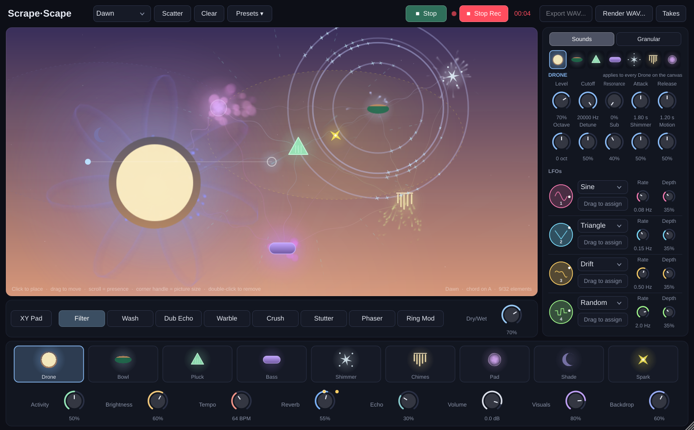
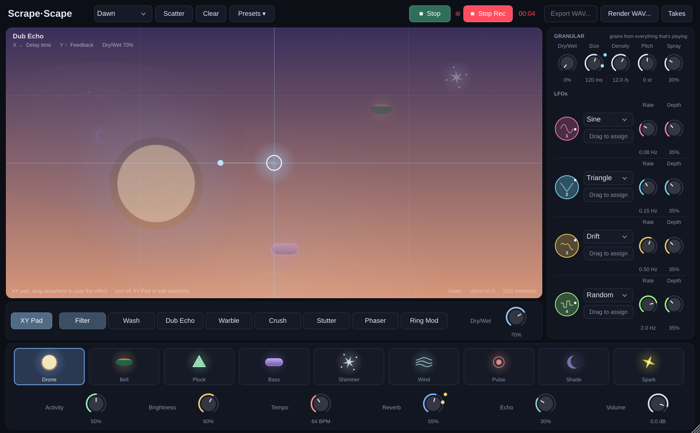
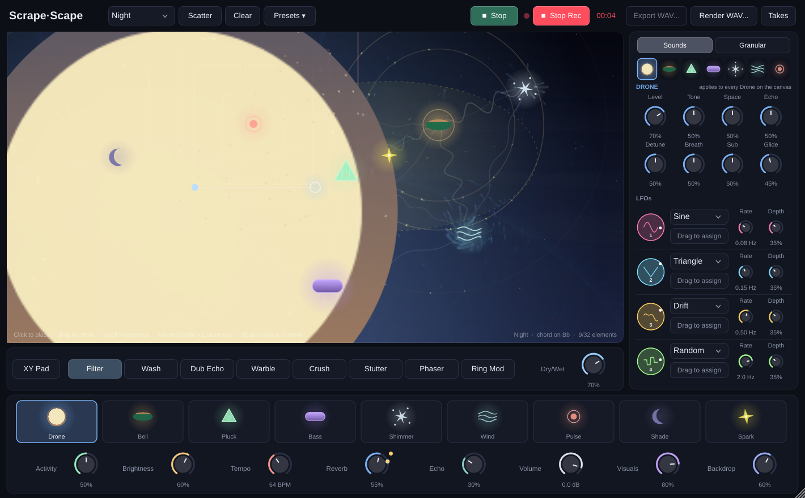
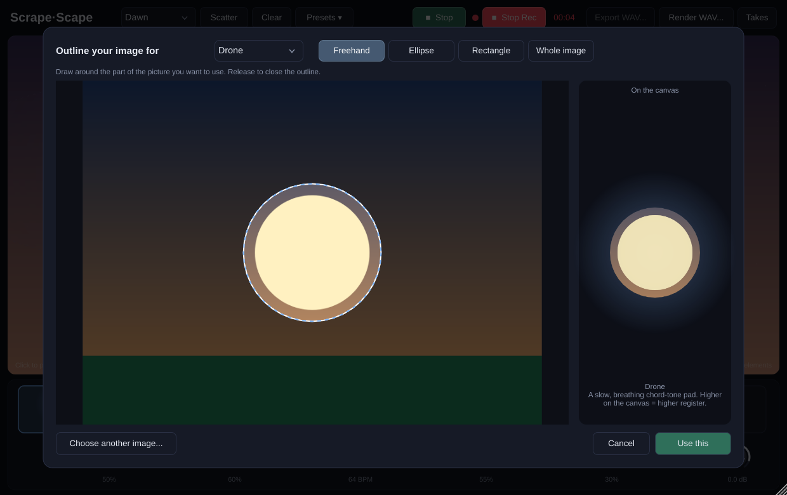

# Scrape·Scape

A generative ambient instrument for macOS. You arrange elements on a canvas, and they play endlessly
evolving music together. You can **record** what you hear and **export it as a WAV file**, or
**render** a scene straight to WAV faster than realtime.

It runs as a **standalone app** and as a **VST3** and **Audio Unit** instrument in your DAW.
It's a universal binary (Apple Silicon + Intel) for macOS 11 or later, including **Sonoma 14.6**.

> Inspired by the idea of "place-the-pieces" generative music apps such as Brian Eno & Peter Chilvers'
> *Scape*. This is an independent project with its own sound engine and visuals. It isn't affiliated
> with or endorsed by them, and it doesn't use any of their material.



---

## Install (pre-built)

1. Open the repo on GitHub → **Actions** → **Build macOS** → the latest successful run → download
   the **Scrape-Scape-macOS** artifact. (If a `v*` tag has been pushed, it's also on the **Releases** page.)
2. Unzip it. You'll get a `Scrape-Scape` folder.
3. Open **Terminal** and run:
   ```bash
   bash ~/Downloads/Scrape-Scape/install_mac.command
   ```
   This copies the app to `~/Applications`, the plugins to `~/Library/Audio/Plug-Ins/`, clears
   macOS's "downloaded from the internet" flag, and opens the app.

The build is ad-hoc signed, not notarized by Apple. If macOS still says it "can't be opened",
right-click the app → **Open** → **Open**, or go to **System Settings → Privacy & Security** and click
**Open Anyway**.

## Build from source (on your Mac)

```bash
xcode-select --install          # once, if you don't have the command line tools
brew install cmake              # once
./scripts/build_mac.sh          # builds and installs app + VST3 + AU
```

The first build downloads JUCE 8 automatically, so it takes a few minutes. The outputs are in
`build/ScrapeScape_artefacts/Release/`.

---

## Using it

| Action | How |
|---|---|
| Start / stop the music | **▶ Play / ■ Stop**. Stop fades out gently and pauses; Play picks up where it left off |
| Place an element | Choose it in the palette, then click the canvas |
| Move | Drag it. Height sets the register (higher = higher pitch), left/right sets the stereo position |
| Resize (louder/softer, wider influence) | Scroll over it |
| Resize just the picture (any size) | Click it, then drag its corner handle ⤡, or Shift-scroll |
| Remove | Double-click, right-click or ⌥-click |
| Change the whole feel | **Mood**: Dawn, Tide, Ember, Glacier, Dusk or Night (key, scale, pace, colour) |
| Random scene / start over | **Scatter** / **Clear** |
| Use your own picture for an element | Drop an image on its palette slot, or right-click the slot |
| Save / load everything | **Presets ▾** |

**Elements**

- **Drone**: an ethereal, slowly breathing drone with airy octave and fifth shimmer. Its horizontal position picks root, third or fifth.
- **Bowl**: crystal singing bowls with pure, slowly beating tones, struck or softly swelling in.
- **Pluck**: a versatile pluck synth, from soft sine harp to bright saw and square plucks, playing wandering figures.
- **Bass**: deep, soft root notes that glide with the chord changes.
- **Shimmer**: a cloud of tiny high sine grains with octave sparkles.
- **Chimes**: tuned wind chimes that ring out in clusters when the breeze picks up.
- **Pad**: a lush, evolving chord pad of detuned voices.
- **Shade** (modifier): darkens, calms and adds reverb to everything inside its dashed circle.
- **Spark** (modifier): brightens and energises everything inside its circle.

A shared conductor moves through a slow chord progression, so every element stays in harmony. Each
element has its own random seed, so no two placements behave the same way.

**Knobs:** Activity, Brightness, Tempo, Reverb, Echo and Volume. All of them can be automated in a DAW.

## Synth controls per engine

The **Sounds** tab in the right sidebar gives every engine its own synth page. Pick an engine from
the icon row, or click an element on the canvas or a palette slot. Every engine has the same six
core controls, plus two that are specific to it:

| Control | What it does |
|---|---|
| **Level** | Volume of this engine |
| **Cutoff** | Low-pass filter (60 Hz to 20 kHz). Lower it to darken the sound |
| **Resonance** | Emphasis at the cutoff, from smooth to whistling. Works with Cutoff |
| **Attack** | How slowly the sound swells in (0.2 to 6.6 s) |
| **Release** | How long it rings out after you remove it (0.2 to 4.2 s), and note decay |
| **Octave** | Transposes the engine by up to two octaves |

Each engine also has four controls that shape its character (the second row of knobs):

| Engine | Character controls |
|---|---|
| Drone | Detune (layer width), Sub (sub-octave), Shimmer (airy octave/fifth partials), Motion (slow drift and breathing) |
| Bowl | Ring (pure crystal to rich metal overtones), Beat (speed of the slow wah-wah), Swell (struck to softly sung), Density |
| Pluck | Wave (sine → triangle → saw → square), Snap (bright, percussive attack), Density, Speed |
| Bass | Drive, Body (upper harmonics), Glide, Walk (steps to the fifth) |
| Shimmer | Rate, Length (glitter to smooth haze), Spread, Sparkle (octave-up grains) |
| Chimes | Breeze (gust strength), Cluster (how many ring together), Metal (bamboo-soft to bright tubes), Spread |
| Pad | Detune (thin to lush), Warmth (bright saw to soft), Voicing (close triad to wide open chord), Motion |

All 70 controls can be automated in a DAW and saved in presets. **Drag any LFO onto any of these
knobs** to animate it, such as sweeping Cutoff for a classic filter wobble. The LFO target menu lists
them grouped by engine.

## Living visuals

While the music plays, the canvas visualises it:

- **Particles** stream from every sounding element: slow spirals from Drones, sparks from Bells,
  streaks from Plucks, soft blobs from Bass, glitter from Shimmer, flowing currents from Wind.
  They're pulled into **orbits around other elements** and **take on the colours** of what they
  pass near, so new colours and patterns emerge where sounds meet.
- **Ripples** spread from struck sounds (circles for Bells and Bass, bursts for Plucks, squares for
  Pulse). **Where ripples from different elements cross, sparks appear**, an interference pattern
  that keeps changing.
- **Threads** link neighbouring elements and vibrate with their combined activity.
- **Drones trace rotating rose curves** that build into spirographs. The number of petals follows
  the current chord.
- **Shade** zones slow particles and tint them violet. **Spark** zones speed them up and brighten them.

The visuals follow the controls, including whatever the LFOs are doing at that moment. Cutoff shifts an
engine's hue, Level sets how much it emits, Release makes ripples and particles last longer, Reverb
lengthens the trails, Brightness changes colour intensity and Granular breaks particles into fragments.
Each sounding element also glows with a halo that pulses with its activity. On the XY pad, **Wash/Dub Echo** stretch the trails, **Crush** pixelates the particles
and **Warble** makes them wobble. The **Visuals** knob sets the overall intensity (0 = off).

## XY effects pad

The strip under the canvas is an effects matrix. Choose an effect, raise **Dry/Wet**, then turn on
**XY Pad**. The whole canvas becomes the pad: drag anywhere to play the effect. Turn **XY Pad**
off again to place and move elements. The effect keeps running at its last position.

| Effect | X (left → right) | Y (bottom → top) |
|---|---|---|
| **Filter** | low-pass ← centre (open) → high-pass | resonance |
| **Wash** | reverb size (far right = freeze) | brightness |
| **Dub Echo** | delay time (moving it bends the pitch, tape style) | feedback (into self-oscillation) |
| **Warble** | wow/flutter depth | speed |
| **Crush** | sample-rate reduction | bit reduction |
| **Stutter** | slice length (tempo-synced, 1/16 beat to 2 beats) | number of repeats |
| **Phaser** | sweep speed | feedback |
| **Ring Mod** | carrier frequency | tremolo ↔ ring modulation |



## Granular

The **GRANULAR** section on the right chops everything that's playing into tiny grains and scatters
them. **Dry/Wet** sets how much you hear. **Size** is grain length (20–500 ms), **Density** is grains
per second, **Pitch** shifts the grains (±12 semitones), and **Spray** scatters them in time and
stereo, adding octave sparkles when turned up high.

## LFOs

There are four LFOs, each with a shape (Sine, Triangle, Saw, Square, Random, Drift), a **Rate**
(0.01–10 Hz) and a **Depth**.

- **Drag an LFO's round handle** onto the XY pad canvas (then choose X, Y or Dry/Wet), or onto any
  knob that can be modulated: Activity, Brightness, Reverb, Echo, FX Dry/Wet and all the granular knobs.
- Modulated knobs show a coloured marker for each LFO on them and a dot that follows the live value.
  On the pad, a second dot shows where the LFO is currently pulling the puck.
- Click an LFO's target button to pick a target from a list or clear it.

## Picture size

Pictures can be **any size**, from tiny to many times bigger than the screen:

- Click an element, then drag its **corner handle ⤡**. The handle always stays inside the canvas, so
  you can shrink even a giant picture back down.
- Or hold **Shift** (or **⌘**) and scroll over a picture.
- **Double-click the handle** to reset the picture to its normal size.
- **⌘-click** always places a new element, even on top of a big picture.

Resizing a picture only changes how it looks. Plain scrolling still changes the element's sound
*presence* (its volume and circle of influence).

**Quality:** photos are kept at their original resolution (up to 8192 px), and presets store the
original file. Every picture is drawn at its exact on-screen pixel size, including on Retina
screens: from a high-quality cache up to 2048 px, and straight from the full-resolution photo above
that. They stay pixel-sharp until they're displayed larger than the photo itself. Beyond that they're
smoothly enlarged, because no extra detail exists in the file. Freehand outlines are stored as smooth
curves, so edges stay clean at any size.

## Backdrop

The canvas background moves slowly. A soft aurora drifts across every mood, and each mood has its
own pattern: **Dawn** sun rays, **Tide** drifting waves, **Ember** rising sparks, **Glacier** a
glinting crystal lattice, **Dusk** slow overlapping ripples, **Night** twinkling stars and faint
constellations. It breathes gently with how busy the music is, blooms softly on chord changes and
crossfades when you change mood. The **Backdrop** knob sets its strength (0 = plain gradient).



## Your own images

Any element can be drawn with your own picture instead of its built-in icon.

1. **Drag an image file onto a palette slot** (Drone, Bell, Shade, ...). If you drop it anywhere else
   in the window, it goes to the currently selected slot. You can also right-click a slot and choose
   **Use an image...**.
2. In the outline editor, pick how to select the part you want:
   - **Freehand**: draw around it like a lasso
   - **Ellipse** / **Rectangle**: drag out a shape
   - **Whole image**: use all of it

   The preview on the right shows how it will look on the canvas. Click **Use this** (or press Return).
3. Every element of that type on the canvas now uses your cut-out. It glows and pulses with the sound.

Right-click a slot to **Re-outline** the image or go **Back to the built-in icon**.

Supported formats on macOS: **JPEG, PNG, TIFF, HEIC, GIF, BMP, WebP, PSD**. Images are stored
inside your presets and DAW projects, so they travel with them.



## Presets

**Presets ▾** saves and loads *everything*: the elements, their positions and picture sizes, mood,
all knobs (including every engine's sound controls), XY pad, granular and LFO settings, and your
custom images.

- **Save preset...** writes a `.scapepreset` file (by default to `~/Music/Scrape-Scape/Presets/`).
  Saved presets appear in the menu under **My presets**.
- **Load preset from file...** loads one from anywhere, or drag a `.scapepreset` file onto the window.
- **Factory scenes** gives you five starting points. They change the scene and knobs but keep
  your images.

## Recording & exporting WAV

- **Record / Stop**: records exactly what you hear. Audio streams to disk as **24-bit WAV** at the
  current sample rate, so takes can be any length. Takes are saved automatically to
  `~/Music/Scrape-Scape/Takes/`. Click **Takes** to open that folder.
- **Export WAV…**: saves the last take wherever you choose.
- **Render WAV…**: choose a length (1–60 minutes) and a file name. The current scene is rendered
  offline to a 24-bit stereo WAV with a smooth fade at the end. This runs far faster than realtime
  (a 30-minute piece takes well under a minute) and doesn't interrupt what you're hearing.

In the **standalone app**, use **Options → Audio/MIDI Settings** (top-left) to choose your output
device and sample rate.

---

## Project layout

```
Source/Engine/     DSP: elements, moods/harmony, voices, FDN reverb, delay, limiter, engine
Source/UI/         Canvas, element glyphs, look & feel
Source/            Plugin processor/editor, WAV recorder, offline renderer
Tests/             Headless smoke test (record → export → render → state round-trip)
scripts/           macOS build and install scripts
.github/workflows/ macOS CI build that produces the downloadable zip
```

Run the tests: `cmake -B build -DSCAPE_BUILD_TESTS=ON && cmake --build build && ./build/ScrapeScapeTests_artefacts/Release/ScrapeScapeTests /tmp`

## License note

Built with [JUCE 8](https://juce.com), which is dual-licensed: AGPLv3 or a commercial JUCE license.
If you distribute this plugin, you must follow one of those licenses.
